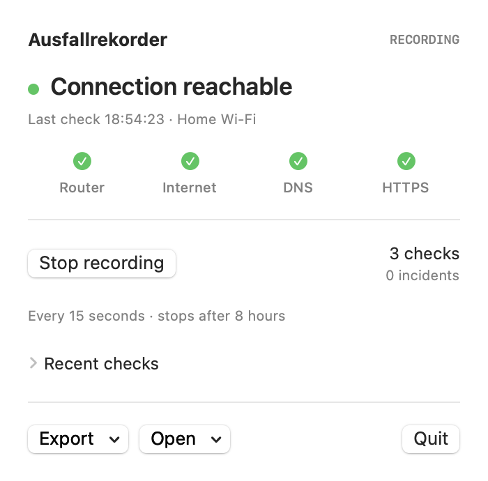
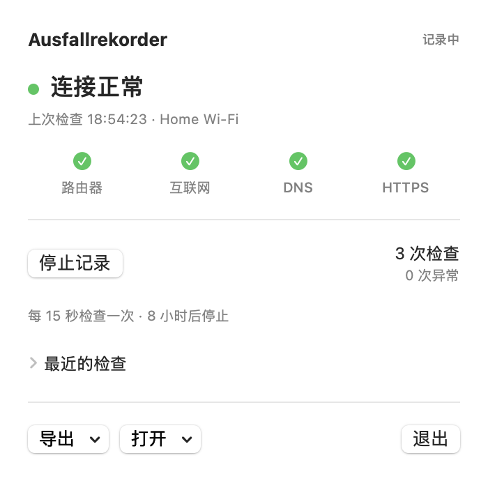

# Ausfallrekorder

[](https://github.com/p2plus/ausfallrekorder/actions/workflows/ci.yml)


[English](README.md) · [Deutsch](docs/README.de.md) · [简体中文](docs/README.zh-Hans.md)

A small, boring tool that does two things well: **measure your connection** and
**give you a report you can actually use**.

Mac menu bar app. Linux CLI. Same engine, same files. No account. No telemetry.




Images are rendered from the real app view with a saved live recording. The example
uses a documentation-only router address. [Example HTML report](docs/example-report.html).

## What it does

- Checks your router, two external IPs, DNS and HTTPS every **15 seconds**.
- Saves each round immediately. A crash does not erase the whole session.
- Exports an offline HTML report, including a comparison with another computer.
- Treats sleep as unobserved time. Does not pretend one failed ping proves your ISP is broken.

## macOS

macOS 14+, Apple Silicon or Intel when built on that architecture.

```sh
sh scripts/build-macos.sh
open dist/Ausfallrekorder.app
```

Click the waveform in the menu bar, then **Start recording**. **Export** saves an
HTML report or the raw recording, even while recording. **Quit** stops, flushes the
recording, and closes the app. No Dock icon and no large permanent window.

The interface and reports support **English, German and Simplified Chinese**.
The Mac follows your preferred system language. The CLI also accepts `--language`:

```sh
./ausfallrekorder-cli record --language en --output wifi.afr
./ausfallrekorder-cli report wifi.afr --language zh-Hans --output report-zh.html
```

Recordings stay in `~/Library/Application Support/Ausfallrekorder/`.
The default run ends after eight hours. Closing the popover keeps recording.

The local build is ad-hoc signed, not notarized. Private CI downloads may trigger
Gatekeeper; use macOS's normal Open Anyway flow if you trust your own build.

## Linux

The Linux version is a terminal program. No browser server, desktop dependencies,
root privileges, or daemon. Tested on Ubuntu 24.04 ARM64; CI also targets x86_64.

Install probe tools (Debian/Ubuntu):

```sh
sudo apt install iproute2 iputils-ping libc-bin libcurl4t64 libstdc++6
```

Download the matching Linux archive from [Releases](https://github.com/p2plus/ausfallrekorder/releases) and unpack it.
The Swift runtime is linked into the binary. `runtime-libraries.txt` records remaining
system library dependencies. Other distributions may need a local build.

```sh
./ausfallrekorder-cli record --label WLAN --output wlan.afr
```

**Ctrl+C** stops cleanly and writes `wlan.html`. Default: eight hours, 15-second interval.

```sh
# Five-minute check
./ausfallrekorder-cli record --duration 300 --output check.afr

# Compare overlapping measurements from two computers
./ausfallrekorder-cli compare wlan.afr lan.afr --output vergleich.html

# Rebuild a report from an interrupted or finished recording
./ausfallrekorder-cli report wlan.afr --output bericht.html
```

Output files are never silently overwritten. Keep the computers' clocks synchronized.
The CLI also runs on macOS.

## Small on purpose

- No third-party Swift packages.
- One round at a time. No retry storms or continuous speed tests.
- Three single pings, one system name lookup, one HTTPS **HEAD** request per round.
- Reuses HTTPS connections. No page downloads, cookies, or response cache.
- Event-driven process completion, bounded timeouts; no polling loop.
- Append-only recording file; no rewriting the entire history every round.
- The compact view can expand the last five checks. No continuous animation.

This still uses network traffic and wakes the machine's CPU briefly. It does not
prevent system sleep. Resource measurements and their limits are in
[docs/verification.md](docs/verification.md).

## What a result means

| Observation | What we can say |
|---|---|
| HTTPS works | A public HTTPS service was reachable. |
| External IP works, HTTPS does not | DNS, TLS, filtering, or that service may be involved. |
| Router works, all external checks fail | External connectivity was not confirmed. |
| Router and external checks fail | Check the local path too; firewalls may block ICMP. |
| No IPv4 gateway found | Router test is unavailable; HTTPS can still work over IPv6. |

Sampling misses some short outages. Time between probes and sleep are not measured
uptime or downtime. Consecutive errors form an episode, whose span is not a claim
that the connection was continuously down. DNS can be answered from the OS cache.
VPNs and captive portals can affect the observations.

## Privacy

Recordings stay on your machine. Probes contact Cloudflare (`1.1.1.1`), Google
(`8.8.8.8`) and `example.com`. Those services see normal connection metadata.
We do not scan the LAN, read browsing history, capture packets, or collect SSIDs.
Files and reports contain the chosen label, timestamps, interface and router address.
Check them before sharing.

## Development

Swift 6.0+ for source builds. No package dependencies.

```sh
swift test
swift build
python3 scripts/smoke.py "$(swift build --show-bin-path)/ausfallrekorder-cli"
```

`Sources/RecorderCore` owns probes, recording, analysis and reports.
`Sources/Ausfallrekorder` is the Mac popover. `Sources/RecorderCLI` is the terminal UI.
The `.afr` format is versioned, newline-delimited JSON. A torn final write can be
ignored; invalid complete rows are rejected. Dates use Unix milliseconds.

The icon is drawn from [source](scripts/make-icon.swift), not a bundled asset pack.
Documentation previews are reproducible with the app's `--render-preview` option.
